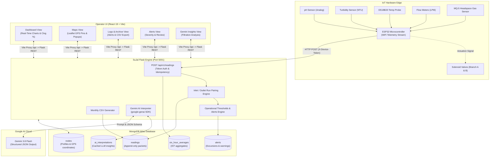
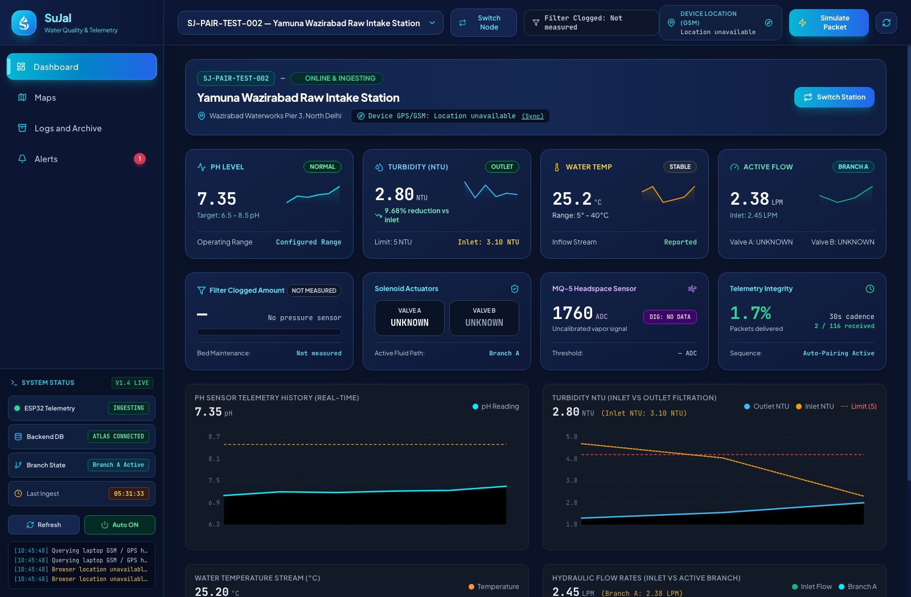
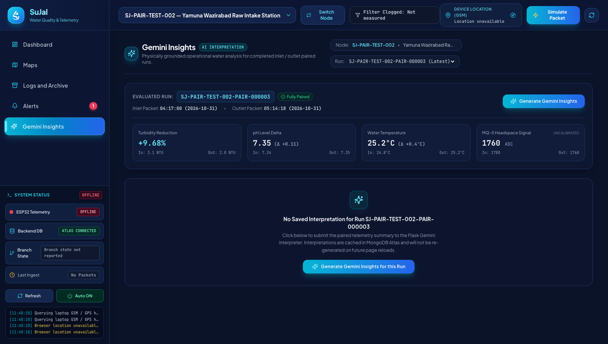
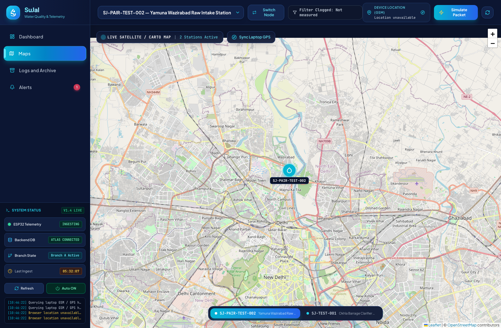
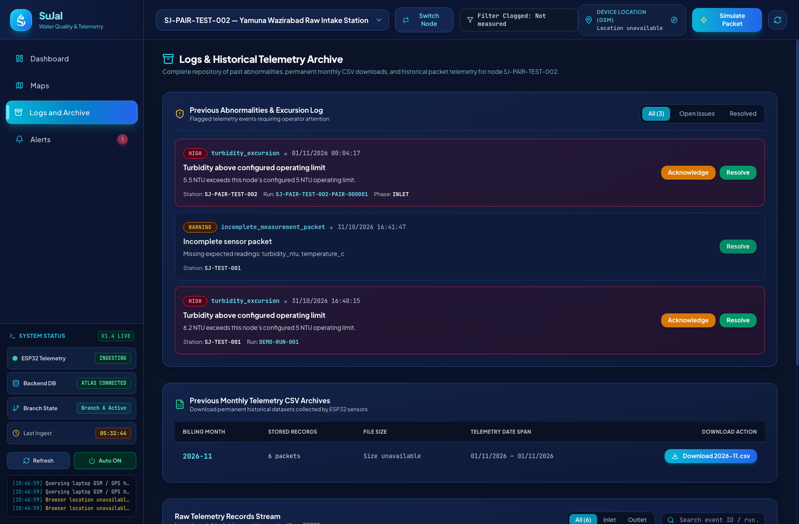

<div align="center">

  

  # SuJal (सुजल)
  ### Real-Time IoT Water Quality Telemetry & AI-Driven Operational Intelligence Platform

  [](https://react.dev/)
  [](https://www.typescriptlang.org/)
  [](https://vitejs.dev/)
  [](https://tailwindcss.com/)
  [](https://www.python.org/)
  [](https://flask.palletsprojects.com/)
  [](https://www.mongodb.com/atlas)
  [](https://ai.google.dev/)
  [](https://leafletjs.com/)

  <p align="center">
    <strong>SuJal</strong> is an end-to-end industrial IoT telemetry and operations dashboard designed for water purification plants, river intake headers, and decentralized water distribution networks. It pairs hardware edge sensor streams with a robust Flask & MongoDB engine, GIS mapping, audit logs, and on-demand Google Gemini AI telemetry interpretation.
  </p>

</div>

---

## 📑 Table of Contents

- [Overview & Architecture](#-overview--architecture)
- [Key Features](#-key-features)
- [System Screenshots](#-system-screenshots)
- [Hardware & IoT Edge Specifications](#-hardware--iot-edge-specifications)
- [Backend REST API Reference](#-backend-rest-api-reference)
- [Operational Rules & Thresholds](#-operational-rules--thresholds)
- [Gemini AI Interpretation Engine](#-gemini-ai-interpretation-engine)
- [Project Directory Structure](#-project-directory-structure)
- [Getting Started](#-getting-started)
  - [Prerequisites](#prerequisites)
  - [Backend Setup](#1-backend-setup)
  - [Frontend Setup](#2-frontend-setup)
  - [Simulating Telemetry Packets](#3-simulating-telemetry-packets)
- [Environment Variables](#-environment-variables)
- [Safety & Reliability Principles](#-safety--reliability-principles)
- [License](#-license)

---

## 🏗 Overview & Architecture

SuJal provides continuous physical monitoring across dual-branch treatment beds and filtration stations. Sensor nodes deployed in the field (powered by ESP32 microcontrollers) stream raw water quality telemetry to the SuJal Flask engine over authenticated HTTP. The backend deduplicates packets, alternates inlet and outlet readings into coherent test runs, evaluates operational thresholds, and persists time-series data to MongoDB Atlas.

Operators interact with a high-performance React 19 single-page dashboard featuring real-time charting, Leaflet GIS mapping, complete abnormality archives with one-click monthly CSV downloads, and on-demand Gemini-powered filtration analysis.



---

## ⚡ Key Features

- **Real-Time Telemetry Dashboard**: Visualizes pH, Turbidity (NTU), Water Temperature (°C), Active Flow Rates (LPM for Inlet, Branch A, and Branch B), Solenoid Valve states, and calculated filter clog estimations.
- **Inlet vs. Outlet Paired Runs**: The backend automatically alternates sequential node packets into paired filtration runs (`inlet` → `outlet`), calculating physical reduction percentages across active filtration beds.
- **Interactive GIS Map**: Powered by Leaflet; visualizes surveyed or GPS-localized water stations with custom glowing markers, health statuses, and live sensor popups.
- **Operator Abnormality & Audit Log**: Filter alerts by state (`open`, `acknowledged`, `resolved`), review excursion histories, and view sensor timestamps down to the second.
- **Permanent Monthly CSV Telemetry Exports**: Generates standard RFC 4180 CSV downloads directly from immutable MongoDB history for regulatory reporting and offline audits.
- **AI-Powered Gemini Insights**: Evaluates verified inlet/outlet paired runs using Google Gemini (`gemini-3.8-flash`) to generate structured operational interpretations, observed physical shifts, and actionable operator checklists.
- **System Status Bar**: Live indicators for ESP32 telemetry ingestion, MongoDB connectivity (`ATLAS CONNECTED`), active branch status, and ticking elapsed last-ingest timer.
- **Laptop GSM / GPS Sync**: Interrogates host hardware geolocation through the browser Geolocation API to localize mobile diagnostic terminals in the field.

---

## 📸 System Screenshots

### 1. Operations Dashboard
> *Live sensor curves, operating ranges, solenoid actuator states, and telemetry history.*
<div align="center">
  
</div>

---

### 2. Gemini AI Telemetry Insights
> *Physically grounded filtration delta analysis, observed changes, and operator action checklists.*
<div align="center">
  
</div>

---

### 3. Interactive GIS Network Map
> *Geographic overview of field nodes, GPS coordinates, and real-time station metrics.*
<div align="center">
  
</div>

---

### 4. Logs, Abnormalities & Monthly Archives
> *Rule-based excursion audit trails, operator acknowledgement workflows, and monthly CSV exports.*
<div align="center">
  
</div>

---

## 🔌 Hardware & IoT Edge Specifications

The edge nodes utilize the **ESP32 DevKit V1** microcontroller connected to analog/digital sensor probes and actuator relays:

| Subsystem | Sensor / Actuator | Interface | Operating Range | Operational Unit |
|---|---|---|---|---|
| **pH** | Analog pH Sensor Probe | ADC (GPIO 34 / 35) | `0.00 – 14.00` | pH |
| **Turbidity** | Optical Turbidity Sensor | ADC (GPIO 32 / 33) | `0.0 – 1000.0` | NTU |
| **Temperature** | DS18B20 Waterproof Probe | OneWire (GPIO 4) | `-20.0 – 85.0` | °C |
| **Flow Rate** | YF-S201 Hall Effect Flowmeters | Digital Pulses (GPIO 18, 19, 21) | `1.0 – 30.0` | LPM (Litres/min) |
| **Headspace Gas** | MQ-5 Combustible Vapor Sensor | Dual: ADC (GPIO 36) + Digital Pin | `0 – 4095` (ADC) | Uncalibrated ADC Signal |
| **Valves** | 12V DC Solenoid Actuators | Optocoupler Relay (GPIO 26, 27) | Digital High / Low | Open / Closed |

### Ingestion Packet Schema
The ESP32 submits JSON packets to `POST /api/v1/readings` at a regular cadence (default 30 seconds):

```json
{
  "node_id": "SJ-PAIR-TEST-002",
  "event_id": "esp32-sample-20261101-00042",
  "timestamp": "2026-11-01T05:14:18Z",
  "active_branch": "A",
  "measurements": {
    "ph": 7.35,
    "turbidity_ntu": 2.80,
    "temperature_c": 25.2,
    "mq5_adc": 1760,
    "mq5_digital": 0,
    "flow_lpm": {
      "inlet": 2.45,
      "branch_a": 2.38,
      "branch_b": 0.00
    }
  },
  "device_status": {
    "wifi": "connected",
    "valve_a": "open",
    "valve_b": "closed"
  }
}
```

> [!NOTE]
> Packets require an `X-Device-Token` header matching `DEVICE_API_TOKEN` configured in the backend environment. A unique index on `(node_id, event_id)` guarantees idempotency if the edge node retries a timed-out transmission.

---

## 📡 Backend REST API Reference

| Method | Endpoint | Description | Auth / Headers |
|---|---|---|---|
| `GET` | `/api/health` | Healthcheck and MongoDB ping | None |
| `POST` | `/api/v1/readings` | Ingests a new telemetry reading packet | `X-Device-Token: <SECRET>` |
| `GET` | `/api/v1/nodes` | Lists all registered node profiles | None |
| `GET` | `/api/v1/nodes/<node_id>/profile` | Retrieves specific node profile & location | None |
| `PUT` | `/api/v1/nodes/<node_id>/profile` | Updates node name, address, and coordinates | `X-Device-Token` |
| `GET` | `/api/v1/nodes/<node_id>/latest` | Retrieves the most recent reading for a node | None |
| `GET` | `/api/v1/nodes/<node_id>/readings` | Reading history with `?limit=100` | None |
| `GET` | `/api/v1/nodes/<node_id>/runs/<run_id>/comparison` | Numeric inlet vs outlet comparison for a run | None |
| `POST` | `/api/v1/nodes/<node_id>/runs/<run_id>/interpretation` | Generates & saves a Gemini interpretation | None (Operator triggered) |
| `GET` | `/api/v1/nodes/<node_id>/runs/<run_id>/interpretation` | Retrieves cached Gemini interpretation | None |
| `GET` | `/api/v1/nodes/<node_id>/alerts` | Lists alerts (`?status=open\|acknowledged\|resolved\|all`) | None |
| `PATCH`| `/api/v1/alerts/<alert_id>` | Updates alert status with optional operator note | None |
| `GET` | `/api/v1/nodes/<node_id>/archives` | Lists available monthly telemetry archives | None |
| `GET` | `/api/v1/nodes/<node_id>/archives/<YYYY-MM>.csv` | Downloads CSV export of raw readings | None |
| `GET` | `/api/v1/nodes/<node_id>/telemetry-completeness` | Evaluates packet delivery rate over last hour | None |
| `GET` | `/api/v1/nodes/<node_id>/averages/6-hour` | Materialized 4x 6-hour daily IST aggregations | None |
| `GET` | `/api/v1/config/thresholds` | Returns configured operational limits | None |

---

## ⚖ Operational Rules & Thresholds

SuJal evaluates non-blocking operational rules upon packet ingestion:

- **Turbidity Excursion**: Turbidity exceeding `TURBIDITY_OPERATING_LIMIT_NTU` (default `5.0 NTU`) opens a high-severity alert.
- **pH Operating Limits**: pH readings outside `PH_MIN_OPERATING` (`6.5`) to `PH_MAX_OPERATING` (`8.5`) flag an operating range alert.
- **Water Temperature**: Temperatures outside `TEMP_MIN_OPERATING_C` (`5.0°C`) to `TEMP_MAX_OPERATING_C` (`40.0°C`) trigger thermal warnings.
- **Active Branch Low-Flow**: If `ACTIVE_FLOW_MIN_LPM` is configured and flow in the declared active branch falls below threshold, the system recommends a valve failover check.
- **Alert Deduplication**: Repeated packets matching an existing open alert condition update the alert's timestamp and reading ID rather than spamming duplicate records.

---

## 🧠 Gemini AI Interpretation Engine

The Gemini Insights subsystem connects to the Google GenAI SDK (`google-genai`) using structured output formatting. 

```
                                  +------------------------------+
                                  | Completed Inlet/Outlet Run   |
                                  +------------------------------+
                                                 |
                                                 v
+------------------------+        +------------------------------+
| MongoDB Atlas Records  | -----> | Summary Extraction Pipeline  |
+------------------------+        +------------------------------+
                                                 |
       (Sends ONLY numeric differences & alerts) |
                                                 v
                                  +------------------------------+
                                  | Google Gemini 3.8 Flash API  |
                                  | (Enforced JSON Response)     |
                                  +------------------------------+
                                                 |
                                                 v
                                  +------------------------------+
                                  | Persist to ai_interpretations|
                                  +------------------------------+
```

### Prompt & Schema Safeguards
1. **Zero Raw Leakage**: Gemini receives only a compact numeric summary of water differences, active alerts, and missing required sensors. Raw database identifiers and credentials are never transmitted.
2. **Deterministic Response Schema**: Output is validated against an enforced schema containing:
   - `observed_changes`: string[]
   - `operational_interpretation`: string
   - `suggested_checks`: string[]
   - `data_quality_notes`: string[]
3. **Immutable Safety Disclaimer**: Appended on the backend before database insertion:
   > *"AI-generated operational interpretation only. Not a water-safety, potability, or certification assessment. Verify readings and follow approved procedures."*
4. **Idempotent Caching**: Once generated for a run, subsequent views retrieve the saved result from MongoDB with `cached: true` without hitting the Google Gemini API.

---

## 📁 Project Directory Structure

```
SuJal/
├── assets/                          # Repository branding & media
│   ├── logo.svg                     # Vector brand symbol (dark)
│   ├── logo-white.svg               # Vector brand symbol (white)
│   └── screenshots/                 # High-resolution UI captures
│       ├── dashboard.png
│       ├── gemini_insights.png
│       ├── maps.png
│       └── logs_archive.png
│
├── backend/                         # Flask REST API engine
│   ├── .env.example                 # Template for environment configuration
│   ├── app.py                       # Main Flask app, routes & MongoDB layer
│   ├── ai_interpreter.py            # Gemini integration via google-genai SDK
│   ├── requirements.txt             # Python dependencies
│   └── README.md                    # Backend-specific developer notes
│
├── frontend/                        # React 19 + TypeScript SPA
│   ├── public/                      # Static assets & SVG icons
│   ├── src/
│   │   ├── components/
│   │   │   ├── Navigation.tsx       # Sidebar navigation & System Status bar
│   │   │   ├── Header.tsx           # Global header, node switcher & GSM sync
│   │   │   └── views/
│   │   │       ├── DashboardView.tsx       # Real-time telemetry dashboard
│   │   │       ├── MapView.tsx             # Interactive Leaflet GIS map
│   │   │       ├── LogsAndArchiveView.tsx  # Abnormalities & CSV download
│   │   │       ├── AlertsView.tsx          # Excursion alerts & workflows
│   │   │       └── GeminiInsightsView.tsx  # AI telemetry interpretation
│   │   ├── services/
│   │   │   └── api.ts               # Typed fetch client for backend endpoints
│   │   ├── types.ts                 # Shared TypeScript interfaces & models
│   │   ├── App.tsx                  # Root state container & hash router
│   │   ├── index.css                # Tailwind utility layers & custom glows
│   │   └── main.tsx                 # React DOM mount point
│   ├── package.json                 # Node dependencies & npm scripts
│   ├── tailwind.config.js           # Tailwind theme & color extensions
│   ├── tsconfig.json                # TypeScript compiler configuration
│   └── vite.config.ts               # Vite configuration with /api reverse proxy
│
├── docs/                            # Documentation assets
├── hardware/                        # Arduino INO sketches and circuit diagrams
│   ├── INO File/                    # ESP32 firmware source files
│   └── Schematics and Diagrams/     # Wiring & sensor schematics
│
├── .gitignore
├── LICENSE
└── README.md                        # Master project documentation
```

---

## 🚀 Getting Started

### Prerequisites

- **Node.js**: v18.0.0 or higher (Node 20+ recommended)
- **Python**: v3.10, 3.11, or 3.12
- **MongoDB Atlas**: Free Tier M0 cluster (or local MongoDB 6.0+)
- **Google Gemini API Key**: Optional, required for Gemini Insights page

---

### 1. Backend Setup

1. Open your terminal and navigate to the `backend/` directory:
   ```bash
   cd backend
   ```

2. Create and activate a Python virtual environment:
   ```bash
   python3 -m venv .venv
   source .venv/bin/activate  # On Windows: .venv\Scripts\activate
   ```

3. Install dependencies:
   ```bash
   pip install -r requirements.txt
   ```

4. Create your `.env` configuration file:
   ```bash
   cp .env.example .env
   ```
   Edit `.env` and provide your MongoDB Atlas connection string:
   ```env
   MONGODB_URI=mongodb+srv://<user>:<password>@cluster0.xxxx.mongodb.net/?retryWrites=true&w=majority
   MONGODB_DATABASE=Sujal
   PORT=5001
   DEVICE_API_TOKEN=your-device-secret-token-here
   ```

5. Launch the backend server:
   ```bash
   python app.py
   ```
   *The server starts on `http://127.0.0.1:5001`. Test connectivity via `http://localhost:5001/api/health`.*

---

### 2. Frontend Setup

1. In a new terminal tab, navigate to the `frontend/` directory:
   ```bash
   cd frontend
   ```

2. Install npm dependencies:
   ```bash
   npm install
   ```

3. Start the Vite development server:
   ```bash
   npm run dev
   ```
   *The dashboard will be accessible at `http://localhost:5173`. The Vite dev server automatically proxies `/api` calls to Flask on port 5001.*

4. To create a production build:
   ```bash
   npm run build
   ```

---

### 3. Simulating Telemetry Packets

To test the system without physical hardware, submit simulated inlet and outlet packets via `curl`:

#### Step A: Submit Inlet Packet
```bash
curl -X POST http://127.0.0.1:5001/api/v1/readings \
  -H "Content-Type: application/json" \
  -H "X-Device-Token: 8d37fc1349b1d8a8bbb58f6f05dbcf7f7e93789a7191926ac93bffc59d2940b9" \
  -d '{
    "node_id": "SJ-PAIR-TEST-002",
    "event_id": "sim-inlet-001",
    "timestamp": "2026-11-01T04:17:00Z",
    "active_branch": "A",
    "measurements": {
      "ph": 7.24,
      "turbidity_ntu": 3.10,
      "temperature_c": 24.8,
      "mq5_adc": 1780,
      "mq5_digital": 0,
      "flow_lpm": { "inlet": 2.41, "branch_a": 2.33, "branch_b": 0.0 }
    },
    "device_status": { "wifi": "connected", "valve_a": "open", "valve_b": "closed" }
  }'
```

#### Step B: Submit Outlet Packet (Completing the Pair)
```bash
curl -X POST http://127.0.0.1:5001/api/v1/readings \
  -H "Content-Type: application/json" \
  -H "X-Device-Token: 8d37fc1349b1d8a8bbb58f6f05dbcf7f7e93789a7191926ac93bffc59d2940b9" \
  -d '{
    "node_id": "SJ-PAIR-TEST-002",
    "event_id": "sim-outlet-001",
    "timestamp": "2026-11-01T05:14:18Z",
    "active_branch": "A",
    "measurements": {
      "ph": 7.35,
      "turbidity_ntu": 2.80,
      "temperature_c": 25.2,
      "mq5_adc": 1760,
      "mq5_digital": 0,
      "flow_lpm": { "inlet": 2.45, "branch_a": 2.38, "branch_b": 0.0 }
    },
    "device_status": { "wifi": "connected", "valve_a": "open", "valve_b": "closed" }
  }'
```

*Navigate to `http://localhost:5173/#/gemini-insights?node=SJ-PAIR-TEST-002` to see the paired run and generate an AI interpretation.*

---

## ⚙ Environment Variables

Configure these settings in your `backend/.env` file:

| Variable | Default Value | Description |
|---|---|---|
| `MONGODB_URI` | *(Required)* | Full MongoDB Atlas connection string |
| `MONGODB_DATABASE` | `Sujal` | Target MongoDB database name |
| `PORT` | `5001` | Local port for Flask API |
| `CORS_ORIGINS` | `http://localhost:5173` | Allowed frontend origins |
| `DEVICE_API_TOKEN` | *(Recommended)* | Shared secret token required in `X-Device-Token` header |
| `TURBIDITY_OPERATING_LIMIT_NTU` | `5.0` | Turbidity threshold triggering operational alert |
| `PH_MIN_OPERATING` | `6.5` | Minimum acceptable operating pH |
| `PH_MAX_OPERATING` | `8.5` | Maximum acceptable operating pH |
| `TEMP_MIN_OPERATING_C` | `5.0` | Minimum water temperature (°C) |
| `TEMP_MAX_OPERATING_C` | `40.0` | Maximum water temperature (°C) |
| `ACTIVE_FLOW_MIN_LPM` | *(Blank)* | Minimum flow rate threshold to detect clogging |
| `EXPECTED_INTERVAL_SECONDS` | `30` | Expected cadence between node telemetry packets |
| `GEMINI_API_KEY` | *(Optional)* | Google AI Studio Gemini API key |
| `GEMINI_MODEL` | `gemini-3.8-flash` | Model identifier for Gemini interpretations |
| `GEMINI_DATA_POLICY_CONFIRMED` | `paid_billing_enabled` | Policy confirmation flag required before calling Gemini |

---

## 🛡 Safety & Reliability Principles

1. **Non-Potability Notice**: Turbidity, pH, temperature, and uncalibrated headspace gas signals are operating metrics only. They **do not certify potability, microbiological disinfection, or compliance with drinking water regulations** (such as WHO or IS 10500 standards).
2. **AI Advisory Role**: The Gemini Insights engine is an operational decision support aid. It evaluates physical deltas and generates recommended operator checks; it does not replace trained plant personnel or certified laboratory testing.
3. **Data Integrity & Idempotency**: All telemetry packets are stored append-only. Idempotency guarantees prevent duplicates during Wi-Fi reconnect bursts, and monthly CSV exports are compiled directly from canonical records.

---

## 📄 License

This project is licensed under the terms of the [MIT License](LICENSE).

---

<div align="center">
  <sub>Developed for next-generation smart water operations and telemetry.</sub>
</div>
